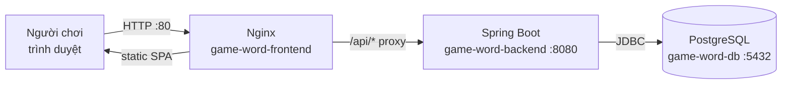
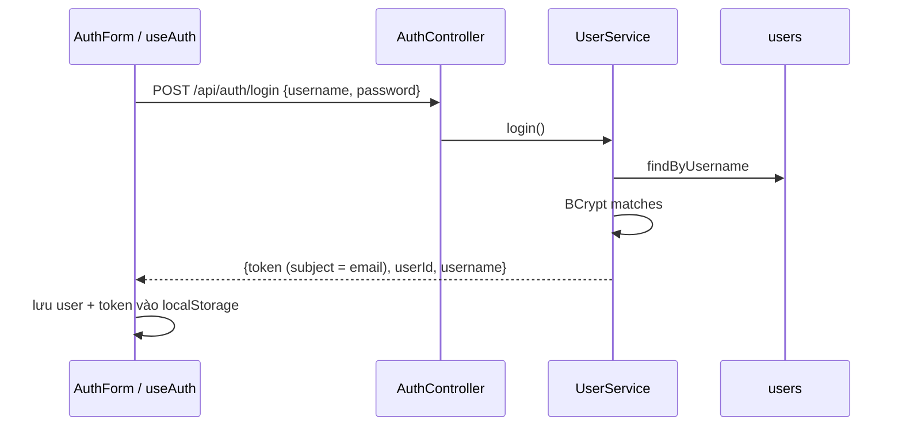

# Kiến trúc tổng thể — Game Đoán Chữ

## 1. Mục đích và phạm vi

- **Mục đích:** Mô tả kiến trúc **hiện tại (Current)** của hệ thống, được xác minh từ mã nguồn tại commit `2417a6d`.
- **Đối tượng đọc:** Lập trình viên mới tham gia dự án, người review kiến trúc.
- **Phạm vi:** Backend Spring Boot, frontend React web, PostgreSQL, triển khai Docker Compose. Ứng dụng mobile (Phase 2) chưa tồn tại và nằm ngoài phạm vi.

## 2. Thuật ngữ và viết tắt

| Thuật ngữ | Định nghĩa |
|-----------|------------|
| JWT | JSON Web Token — token xác thực không trạng thái |
| JPA | Jakarta Persistence API, dùng qua Spring Data JPA/Hibernate |
| SPA | Single Page Application |
| Từ ghép | Từ khóa cần đoán, gồm 2 phần (`part1` + `part2`), lưu không dấu, viết hoa (ví dụ `MAYTINH`) |
| Lượt đoán (attempt) | Một lần người chơi gửi chuỗi đoán |

## 3. Công nghệ (đã xác minh)

| Thành phần | Công nghệ | Nguồn |
|-----------|-----------|-------|
| Backend | Java 17, Spring Boot 3.2.5 (Web, Data JPA, Validation, Security), Lombok, jjwt 0.12.3, Liquibase | `backend/game-word-server/pom.xml` |
| Frontend | React 18.3, React Router 6.30, Axios 1.x, lucide-react, Vite 5.4, TypeScript 5.6, Vitest 2.1 | `frontend/game-word-web/package.json` |
| Database | PostgreSQL 15 (image `postgres:15-alpine`) | `docker-compose.yml` |
| Web server | Nginx 1.27 (phục vụ SPA + reverse proxy `/api/`) | `frontend/game-word-web/nginx.conf` |

## 4. Sơ đồ ngữ cảnh — Current

Khi chạy local (không Docker), Vite dev server (cổng 3000) proxy `/api` tới `http://localhost:8080` (`frontend/game-word-web/vite.config.js`).

## 5. Cấu trúc module

### 5.1 Backend — `backend/game-word-server/src/main/java/com/gameword`

| Package | Thành phần | Trách nhiệm |
|---------|-----------|-------------|
| (gốc) | `GameWordServerApplication` | Entry point; `CommandLineRunner` seed 20 từ khi bảng `words` rỗng |
| `config` | `SecurityConfig`, `JwtAuthFilter`, `JwtUtil`, `GameConfig` | Bảo mật, JWT, cấu hình game (`game.*`) |
| `controller` | `AuthController`, `GameController`, `WordController`, `HistoryController`, `LeaderboardController` | REST endpoint — xem [DOC-002](../api/api-reference.md) |
| `service` | `UserService`, `GameService`, `WordService`, `HistoryService`, `LeaderboardService`, `UserDetailServiceImpl` | Nghiệp vụ |
| `repository` | `UserRepository`, `WordRepository`, `GameHistoryRepository` | Spring Data JPA |
| `model` | `User`, `Word`, `GameHistory` | JPA entity — xem [DOC-003](../database/database-design.md) |
| `dto` | `AuthResponse`, `GuessRequest`, `GuessResponse`, `CellResult`, ... | Request/response |
| `exception` | `GlobalExceptionHandler` | Chuyển exception thành JSON lỗi |

Quy ước hiện tại: constructor injection (trừ `JwtAuthFilter` dùng `@Autowired` field), DTO dùng Lombok `@Data @Builder`, lỗi nghiệp vụ ném `RuntimeException` và được map thành HTTP 400.

### 5.2 Frontend — `frontend/game-word-web/src` (React + TypeScript, viết lại 2026-10-24)

| Thư mục / file | Trách nhiệm |
|----------------|-------------|
| `main.tsx`, `App.tsx` | Entry point; `AuthProvider` + router (`/`, `/login`, `/register`, `/leaderboard`, `/history`, 404) |
| `types/api.ts` | Kiểu dữ liệu khớp DTO backend |
| `services/api.ts` | Axios instance (`VITE_API_BASE_URL`, mặc định `/api`), gắn `Authorization: Bearer`, chuyển lỗi backend thành thông báo tiếng Việt |
| `hooks/useAuth.tsx` | `AuthContext`; lưu `token`, `user` trong `localStorage`; tự đăng xuất khi token hết hạn |
| `components/layout/AppLayout.tsx` | Header, điều hướng, footer |
| `components/common/` | `StatusMessage` (loading/error/empty + thử lại), `ProtectedRoute` |
| `features/game/` | `GamePage`, `GameBoard` (ô chia nhóm theo `partLengths`), `GuessInput` (ô nhập text thường, giữ nguyên chuỗi gõ để không phá bộ gõ tiếng Việt; chữ cái được bỏ dấu và điền lên bảng), `Keyboard` (bàn phím ảo + bàn phím thật), `GameResult`, `GameRules` (luật chơi luôn hiển thị); `useGame` + reducer thuần `gameState.ts`. Nút "Từ khác" chỉ bật sau khi đoán đúng |
| `features/auth/` | `AuthPage` (đăng nhập/đăng ký, validation phía client) |
| `features/leaderboard/`, `features/history/` | Bảng xếp hạng; lịch sử gom theo ván (`groupHistory.ts`) |
| `styles/global.css` | Design token (sáng/tối), responsive, giảm chuyển động theo `prefers-reduced-motion` |

State: React state + Context + `useReducer`, không dùng thư viện state riêng. Test: Vitest + Testing Library (`npm test`), type-check `npm run typecheck`.

## 6. Luồng xử lý chính — Current

### 6.1 Đăng nhập

### 6.2 Chơi một ván

1. `GamePage` (hook `useGame`) gọi `POST /api/game/start?excludedIds=` khi mount. Người chơi được backend xác định từ JWT; không có token thì là khách.
2. `GameService.startGame` lấy từ ngẫu nhiên, lưu bản ghi `game_histories` với `attempt = 0` và trả về `gameId` (id của bản ghi đó).
3. Mỗi lượt, frontend gửi `POST /api/game/guess {gameId, guess}`.
4. `GameService.makeGuess`:
   - Kiểm tra ván tồn tại và thuộc đúng người chơi; số lượt = số lượt đoán đã có của `gameId` + 1.
   - Đánh giá từng ký tự bằng `evaluateGuess` (mục 7), lưu lịch sử; khi kết thúc ván thì cập nhật điểm / số ván cho người đã đăng nhập và trả `answer`.
5. Khi ván kết thúc, frontend thêm `wordId` vào danh sách loại trừ của phiên và hiện nút "Màn tiếp theo" / "Chơi ván mới".

## 7. Luật chơi được cài đặt — Current

| Tham số | Giá trị mặc định | Thuộc tính cấu hình |
|---------|------------------|---------------------|
| Số lượt tối đa | 10 | `game.guess.max-attempts` ⚠ |
| Điểm tối thiểu / tối đa | 10 / 100 | `game.score.min` / `game.score.max` ⚠ |

⚠ `GameConfig` bind với prefix `game` và các field `maxAttempts`, `scoreMin`, `scoreMax`, tức khóa hợp lệ là `game.max-attempts`, `game.score-min`, `game.score-max`. Các khóa trong `application*.properties` **không khớp**, nên giá trị đang dùng là mặc định trong code (R-06).

Màu phản hồi (`GameService.evaluateGuess`):

| Màu | Điều kiện |
|-----|-----------|
| `GREEN` | Ký tự đúng vị trí |
| `YELLOW` | Ký tự có trong từ nhưng sai vị trí |
| `BLUE` | Nguyên âm có trong từ, sai vị trí, và từ đích có nguyên âm cùng gốc nhưng khác dấu. Do từ trong kho lưu không dấu, trường hợp này thực tế hiếm khi xảy ra |
| `BLACK` | Ký tự không có trong từ |

Công thức điểm (`computeScore`): `round(min + (1 - (attempt-1)/max) * (max_score - min_score))`, kẹp trong `[min, max]`. Với mặc định: lượt 1 = 100 điểm, lượt 10 = 19 điểm. Với người đã đăng nhập, điểm được cộng vào `users.total_score` (thắng) và `games_played` / `games_won` được cập nhật; khách chỉ thấy điểm trong response.

## 8. Bảo mật — Current (tóm tắt)

- Stateless JWT (HMAC, hết hạn mặc định 24h – `jwt.expiration=86400000`), mật khẩu băm BCrypt.
- Public: `/api/auth/**`, `/api/words/**`, `/api/leaderboard/**`, `/api/game/**`. Cần xác thực: `/api/history/**`, các đường khác.
- Subject JWT là username; token lỗi/hết hạn được bỏ qua (request xử lý như khách).
- CORS trong `SecurityConfig` cho phép mọi origin kèm credentials; cấu hình `spring.mvc.cors.*` và biến `CORS_ALLOWED_ORIGINS` không được sử dụng.
- Các vấn đề bảo mật chi tiết: [DOC-005](../analysis/project-analysis-report.md).

## 9. Nguồn bằng chứng

`pom.xml`, `package.json`, `vite.config.js`, `nginx.conf`, `docker-compose.yml`, toàn bộ package `com.gameword`, `frontend/game-word-web/src/**`.

## 10. Giả định và câu hỏi mở

- Đã quyết định (2026-10-24): khách được chơi nhưng không được cộng điểm; lượt đoán tính theo ván (`game_id`).
- `OPEN QUESTION:` Kho từ có cần hỗ trợ tiếng Việt có dấu (khi đó màu `BLUE` mới có ý nghĩa)?

## 11. Lịch sử thay đổi

| Phiên bản | Ngày | Mô tả |
|-----------|------|-------|
| 0.1 | 2026-10-24 | Khởi tạo từ phân tích mã nguồn |
| 0.2 | 2026-10-24 | Frontend React + TypeScript, luồng game theo `gameId`, điểm được lưu |
