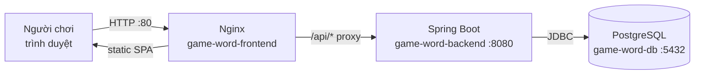
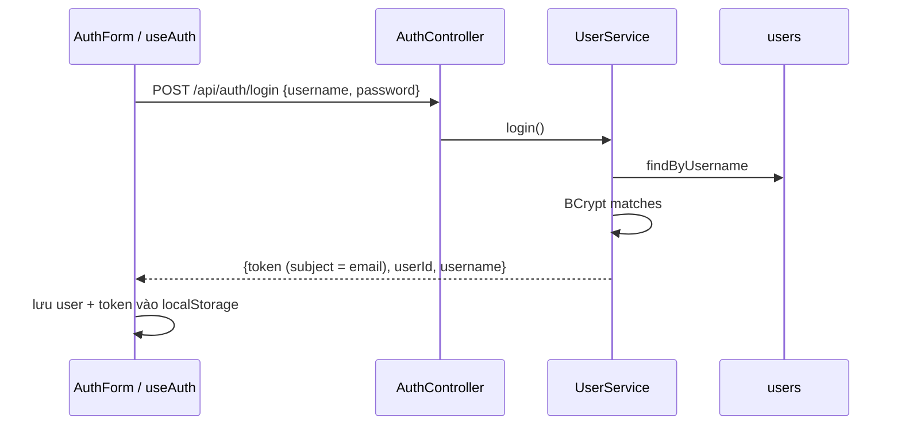

# Kiến trúc tổng thể — Game Đoán Chữ

## 1. Mục đích và phạm vi

- **Mục đích:** Mô tả kiến trúc **hiện tại (Current)** của hệ thống, được xác minh từ mã nguồn tại commit `2417a6d`.
- **Đối tượng đọc:** Lập trình viên mới tham gia dự án, người review kiến trúc.
- **Phạm vi:** Backend Spring Boot, frontend React web, PostgreSQL, triển khai Docker Compose. Ứng dụng mobile (Phase 2) chưa tồn tại và nằm ngoài phạm vi.

## 2. Thuật ngữ và viết tắt

| Thuật ngữ | Định nghĩa |
|-----------|------------|
| JWT | JSON Web Token — token xác thực không trạng thái |
| JPA | Jakarta Persistence API, dùng qua Spring Data JPA/Hibernate |
| SPA | Single Page Application |
| Từ ghép | Từ khóa cần đoán, gồm 2 phần (`part1` + `part2`), lưu không dấu, viết hoa (ví dụ `MAYTINH`) |
| Lượt đoán (attempt) | Một lần người chơi gửi chuỗi đoán |

## 3. Công nghệ (đã xác minh)

| Thành phần | Công nghệ | Nguồn |
|-----------|-----------|-------|
| Backend | Java 17, Spring Boot 3.2.5 (Web, Data JPA, Validation, Security), Lombok, jjwt 0.12.3, Liquibase | `backend/game-word-server/pom.xml` |
| Frontend | React ^18.2, React Router ^6.20, Axios ^1.6, lucide-react, Vite ^5 — **JavaScript (JSX), không dùng TypeScript** | `frontend/game-word-web/package.json` |
| Database | PostgreSQL 15 (image `postgres:15-alpine`) | `docker-compose.yml` |
| Web server | Nginx 1.27 (phục vụ SPA + reverse proxy `/api/`) | `frontend/game-word-web/nginx.conf` |

## 4. Sơ đồ ngữ cảnh — Current

Khi chạy local (không Docker), Vite dev server (cổng 3000) proxy `/api` tới `http://localhost:8080` (`frontend/game-word-web/vite.config.js`).

## 5. Cấu trúc module

### 5.1 Backend — `backend/game-word-server/src/main/java/com/gameword`

| Package | Thành phần | Trách nhiệm |
|---------|-----------|-------------|
| (gốc) | `GameWordServerApplication` | Entry point; `CommandLineRunner` seed 20 từ khi bảng `words` rỗng |
| `config` | `SecurityConfig`, `JwtAuthFilter`, `JwtUtil`, `GameConfig` | Bảo mật, JWT, cấu hình game (`game.*`) |
| `controller` | `AuthController`, `GameController`, `WordController`, `HistoryController`, `LeaderboardController` | REST endpoint — xem [DOC-002](../api/api-reference.md) |
| `service` | `UserService`, `GameService`, `WordService`, `HistoryService`, `LeaderboardService`, `UserDetailServiceImpl` | Nghiệp vụ |
| `repository` | `UserRepository`, `WordRepository`, `GameHistoryRepository` | Spring Data JPA |
| `model` | `User`, `Word`, `GameHistory` | JPA entity — xem [DOC-003](../database/database-design.md) |
| `dto` | `AuthResponse`, `GuessRequest`, `GuessResponse`, `CellResult`, ... | Request/response |
| `exception` | `GlobalExceptionHandler` | Chuyển exception thành JSON lỗi |

Quy ước hiện tại: constructor injection (trừ `JwtAuthFilter` dùng `@Autowired` field), DTO dùng Lombok `@Data @Builder`, lỗi nghiệp vụ ném `RuntimeException` và được map thành HTTP 400.

### 5.2 Frontend — `frontend/game-word-web/src`

| File | Trách nhiệm |
|------|-------------|
| `main.jsx` | Entry point |
| `App.jsx` | Router và các page `GameBoardPage`, `HistoryPage` |
| `hooks/useAuth.jsx` | `AuthContext`; lưu `user`, `token` trong `localStorage` |
| `services/api.js` | Axios instance `baseURL: '/api'`, gắn header `Authorization: Bearer` |
| `components/GameBoard.jsx` | Lưới đoán, ô nhập, tô màu ô theo `CellResult.color` |
| `components/AuthForm.jsx`, `Header.jsx`, `Leaderboard.jsx` | Đăng nhập/đăng ký, header, bảng xếp hạng |

Route: `/` (chơi), `/login`, `/register`, `/leaderboard`, `/history`. State quản lý bằng React state + Context, không dùng thư viện state riêng. Không có route guard.

## 6. Luồng xử lý chính — Current

### 6.1 Đăng nhập

### 6.2 Chơi một ván

1. `GameBoardPage` gọi `POST /api/game/start?userId=&excludedIds=` khi mount.
2. `GameService.startGame` lấy từ ngẫu nhiên (`WordService.getRandomWord`), nếu có `userId` thì lưu một bản ghi `game_histories` với `attempt = 0`.
3. Mỗi lượt, `GameBoard` gửi `POST /api/game/guess {wordId, guess, userId}`.
4. `GameService.makeGuess`:
   - Số lượt = số bản ghi `game_histories` có cùng `word_id` + 1 (xem lỗi R-04 trong [DOC-005](../analysis/project-analysis-report.md)).
   - Đánh giá từng ký tự bằng `evaluateGuess` (mục 7), lưu lịch sử, tính điểm nếu đúng.
5. Khi đoán đúng, frontend thêm `wordId` vào `excludedIds` và hiển thị nút "Màn tiếp theo".

## 7. Luật chơi được cài đặt — Current

| Tham số | Giá trị mặc định | Thuộc tính cấu hình |
|---------|------------------|---------------------|
| Số lượt tối đa | 10 | `game.guess.max-attempts` ⚠ |
| Điểm tối thiểu / tối đa | 10 / 100 | `game.score.min` / `game.score.max` ⚠ |

⚠ `GameConfig` bind với prefix `game` và các field `maxAttempts`, `scoreMin`, `scoreMax`, tức khóa hợp lệ là `game.max-attempts`, `game.score-min`, `game.score-max`. Các khóa trong `application*.properties` **không khớp**, nên giá trị đang dùng là mặc định trong code (R-06).

Màu phản hồi (`GameService.evaluateGuess`):

| Màu | Điều kiện |
|-----|-----------|
| `GREEN` | Ký tự đúng vị trí |
| `YELLOW` | Ký tự có trong từ nhưng sai vị trí |
| `BLUE` | Nguyên âm có trong từ, sai vị trí, và từ đích có nguyên âm cùng gốc nhưng khác dấu. Do từ trong kho lưu không dấu, trường hợp này thực tế hiếm khi xảy ra |
| `BLACK` | Ký tự không có trong từ |

Công thức điểm (`computeScore`): `round(min + (1 - (attempt-1)/max) * (max_score - min_score))`, kẹp trong `[min, max]`. Với mặc định: lượt 1 = 100 điểm, lượt 10 = 19 điểm. Điểm chỉ được trả về trong response, **không được cộng vào `users.total_score`** (R-05).

## 8. Bảo mật — Current (tóm tắt)

- Stateless JWT (HMAC, hết hạn mặc định 24h – `jwt.expiration=86400000`), mật khẩu băm BCrypt.
- Public: `/api/auth/**`, `/api/words/**`, `/api/leaderboard/**`. Cần xác thực: `/api/game/**`, `/api/history/**`, các đường khác.
- CORS trong `SecurityConfig` cho phép mọi origin kèm credentials; cấu hình `spring.mvc.cors.*` và biến `CORS_ALLOWED_ORIGINS` không được sử dụng.
- Các vấn đề bảo mật chi tiết: [DOC-005](../analysis/project-analysis-report.md).

## 9. Nguồn bằng chứng

`pom.xml`, `package.json`, `vite.config.js`, `nginx.conf`, `docker-compose.yml`, toàn bộ package `com.gameword`, `frontend/game-word-web/src/**`.

## 10. Giả định và câu hỏi mở

- `OPEN QUESTION:` Khách (chưa đăng nhập) có được phép chơi không? Frontend cho phép, nhưng backend yêu cầu xác thực cho `/api/game/**`.
- `OPEN QUESTION:` Lượt đoán nên tính theo ván chơi (session) hay theo từ? Hiện chưa có khái niệm "ván chơi".
- `OPEN QUESTION:` Kho từ có cần hỗ trợ tiếng Việt có dấu (khi đó màu `BLUE` mới có ý nghĩa)?

## 11. Lịch sử thay đổi

| Phiên bản | Ngày | Mô tả |
|-----------|------|-------|
| 0.1 | 2026-10-24 | Khởi tạo từ phân tích mã nguồn |
