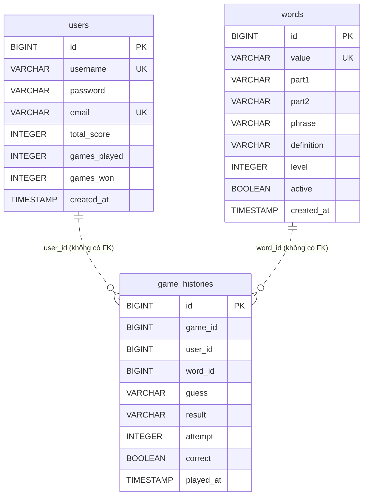

# Thiết kế cơ sở dữ liệu — game_word_db

## 1. Mục đích và phạm vi

- **Mục đích:** Mô tả schema **hiện tại (Current)** của PostgreSQL theo Liquibase changelog `v1.0.0` và JPA entity.
- **Đối tượng đọc:** Lập trình viên backend, DBA.
- **Nguồn sự thật:** `backend/game-word-server/src/main/resources/db/changelog/`. Hibernate chạy `ddl-auto=validate` nên entity phải khớp changelog.

## 2. ERD — Current

Quan hệ chỉ là logic: changelog **không tạo foreign key**; entity `GameHistory` lưu `userId`, `wordId` dạng `Long`, không dùng `@ManyToOne`.

## 3. Data dictionary

### 3.1 `users` (entity `com.gameword.model.User`)

| Cột | Kiểu | Null | Mặc định | Ràng buộc | Mô tả |
|-----|------|------|----------|-----------|-------|
| `id` | BIGINT | Không | auto increment | PK | |
| `username` | VARCHAR(255) | Không | | `uk_users_username` | Tên đăng nhập |
| `password` | VARCHAR(255) | Không | | | Hash BCrypt — dữ liệu nhạy cảm |
| `email` | VARCHAR(255) | Không | | `uk_users_email` | Dữ liệu cá nhân; dùng làm subject JWT |
| `total_score` | INTEGER | Có | 0 | | Tổng điểm (hiện không được cập nhật, R-05) |
| `games_played` | INTEGER | Có | 0 | | Số ván đã chơi |
| `games_won` | INTEGER | Có | 0 | | Số ván thắng |
| `created_at` | TIMESTAMP | Có | | | Gán bởi `@PrePersist` |

### 3.2 `words` (entity `Word`)

| Cột | Kiểu | Null | Mặc định | Ràng buộc | Mô tả |
|-----|------|------|----------|-----------|-------|
| `id` | BIGINT | Không | auto increment | PK | |
| `value` | VARCHAR(255) | Không | | index `idx_words_value` (không còn unique từ v1.3.0) | Từ ghép, viết hoa, không dấu; nhiều từ có thể trùng (vd "bàn tay" / "bán tay") |
| `part1`, `part2` | VARCHAR(255) | Không | | | Hai tiếng của từ, không dấu (dùng tính `partLengths`) |
| `phrase` | VARCHAR(255) | Có | | `uk_words_phrase` | Từ có dấu, cách nhau bằng dấu cách (vd `máy tính`); là đáp án dùng để chấm (so từng chữ có dấu theo vị trí). Null với từ mẫu cũ |
| `level` | INTEGER | Không | | | Cấp độ 1–5 theo độ phổ biến |
| `definition` | VARCHAR(1000) | Có | | | Giải nghĩa tiếng Việt (tối đa 3 nghĩa, cách nhau bởi xuống dòng); nguồn Wiktionary tiếng Việt, CC BY-SA 4.0. Null nếu chưa có |
| `active` | BOOLEAN | Không | true | | Chỉ từ active mới được random |
| `created_at` | TIMESTAMP | Có | | | Gán bởi `@PrePersist` |

### 3.3 `game_histories` (entity `GameHistory`)

| Cột | Kiểu | Null | Ràng buộc | Mô tả |
|-----|------|------|-----------|-------|
| `id` | BIGINT | Không | PK | |
| `game_id` | BIGINT | Có | index `idx_histories_game` | Id của bản ghi bắt đầu ván (`attempt = 0`); dùng để đếm lượt theo ván. Null với dữ liệu trước v1.1.0 |
| `user_id` | BIGINT | Có | index `idx_histories_user` | Null với người chơi khách |
| `word_id` | BIGINT | Không | index `idx_histories_word` | |
| `guess` | VARCHAR(255) | Không | | Chuỗi đoán đã chuẩn hóa chữ hoa; `""` cho bản ghi bắt đầu ván |
| `result` | VARCHAR(255) | Không | | Danh sách màu, phân cách dấu phẩy |
| `attempt` | INTEGER | Không | | Số thứ tự lượt; `0` = bản ghi bắt đầu ván |
| `correct` | BOOLEAN | Không | | |
| `played_at` | TIMESTAMP | Có | | Gán bởi `@PrePersist` |

## 4. Migration

| Changeset | Tác giả | Nội dung |
|-----------|---------|----------|
| `1` | kilo | Tạo `users` |
| `2` | kilo | Tạo `words` |
| `3` | kilo | Tạo `game_histories` |
| `4` | kilo | Index `idx_histories_user`, `idx_histories_word` |
| `5` | claude | `v1.1.0/add-game-id.xml`: thêm cột `game_histories.game_id` và index `idx_histories_game` |
| `6` | claude | `v1.2.0/words-dictionary.xml`: thêm cột `words.phrase` |
| `7` | claude | Nạp 2000 từ 2 tiếng từ `v1.2.0/words-vi-2000.csv` bằng `loadUpdateData` (khóa `value`; trùng thì cập nhật) |
| `8` | claude | `active = false` cho từ không có `phrase` (từ mẫu cũ); gán `created_at` còn trống |
| `9` | claude | `v1.3.0/words-dictionary-all.xml`: bỏ `uk_words_value`, thêm `uk_words_phrase`, index `idx_words_value` |
| `11` | claude | `v1.4.0/words-definition.xml`: thêm cột `words.definition` |
| `12` | claude | Nạp 22.670 giải nghĩa từ `v1.4.0/definitions-vi.csv` qua bảng tạm `definitions_import` + `UPDATE … FROM` theo `phrase` |
| `10` | claude | Nạp toàn bộ 44.920 từ 2 tiếng (`v1.3.0/words-vi-all.csv`) qua bảng tạm `words_import` + `INSERT … ON CONFLICT (phrase)` |

- Master: `db/changelog/db.changelog-master.xml` → include `v1.0.0/initial-schema.xml`, `v1.1.0/add-game-id.xml` (đường dẫn tương đối, `relativeToChangelogFile="true"`).
- Giá trị mặc định cột khai báo bằng thuộc tính `defaultValueNumeric` / `defaultValueBoolean` (bản gốc dùng thẻ `<valueDefault>` không hợp lệ, đã sửa 2026-10-24 trước khi changeset chạy lần đầu).
- Liquibase chạy tự động khi ứng dụng khởi động (`spring.liquibase.enabled=true`).
- Quy trình code-first: `liquibase-maven-plugin` + `liquibase-hibernate6` sinh diff vào `db/changelog/generated/` (`mvn liquibase:diff` / `diffChangeLog`) dựa trên `liquibase.properties` (chỉ dùng local).
- Thay đổi schema mới: thêm file changelog mới (ví dụ `v1.1.0/...xml`) và include vào master; **không sửa changeset đã chạy**.

## 5. Dữ liệu khởi tạo

Dữ liệu từ do Liquibase quản lý (changeset 7), không còn seed trong code Java (đã bỏ `CommandLineRunner` ngày 2026-10-24).

| Mục | Nội dung |
|-----|----------|
| File | `src/main/resources/db/changelog/v1.2.0/words-vi-2000.csv` (cột `value,part1,part2,phrase,level,active`) |
| Nguồn từ | [duyet/vietnamese-wordlist](https://github.com/duyet/vietnamese-wordlist) Viet22K (ứng viên) + Viet11K (ưu tiên) — **GPL-2.0** |
| Xếp hạng | Tần suất từng tiếng từ [hermitdave/FrequencyWords](https://github.com/hermitdave/FrequencyWords) `vi_50k` (CC BY-SA 4.0), chỉ dùng để tính điểm, không đưa vào repo |
| Script | `backend/game-word-server/tools/select_words.py`: `python -I select_words.py Viet22K.txt Viet11K.txt vi_50k.txt words-vi-2000.csv` |
| Tiêu chí | Đúng 2 tiếng, chữ thường, chỉ chữ cái tiếng Việt (loại f/j/w/z), 4–10 chữ cái, bỏ từ láy trùng, bỏ từ mà cả 2 tiếng là hư từ/đại từ, bỏ danh sách từ tục; trùng `value` giữ từ phổ biến hơn |
| Cấp độ | Theo thứ hạng: 667 từ phổ biến nhất level 1, 667 level 2, 666 level 3 |

Kết quả trên DB dev: 2017 bản ghi, 2000 active có `phrase`, 17 từ mẫu cũ bị tắt (còn được `game_histories` tham chiếu).

**Toàn bộ từ điển (v1.3.0):** `tools/build_dictionary.py` lấy tất cả từ 2 tiếng hợp lệ của Viet74K (chữ thường, chỉ chữ cái tiếng Việt, ≤ 12 chữ cái, bỏ từ tục) — 44.920 từ. Cấp độ: 2000 từ phổ biến nhất level 1–3; có trong Viet22K level 4; chỉ có trong Viet74K level 5 (cấp độ là ước lượng, một số từ thông dụng như "công bằng" vẫn ở level 5). DB dev sau khi nạp: 44.947 bản ghi, 44.930 active (level 1–3: 2010, level 4: 15.368, level 5: 27.552).

**Giải nghĩa (v1.4.0):** `tools/extract_definitions.py` đọc dump `viwiktionary-latest-pages-articles.xml.bz2` (bản 01/10/2026), lấy phần tiếng Việt của trang có tiêu đề trùng `phrase`, tối đa 3 dòng định nghĩa `# …` (bỏ ví dụ `#:`/trích dẫn `#*`), bỏ cú pháp wiki. Độ phủ: 22.670 / 44.930 từ active (level 1–3 khoảng 72%, level 4 khoảng 75%, level 5 khoảng 35%). Giấy phép CC BY-SA 4.0: giao diện luôn ghi nguồn kèm link tới trang Wiktionary.

`OPEN QUESTION:` `/api/game/start` chọn ngẫu nhiên trên mọi từ active nên phần lớn là từ ít gặp (level 4–5); cân nhắc chỉ chọn level ≤ 3 hoặc theo độ khó người chơi chọn.

`OPEN QUESTION:` Danh sách sinh tự động từ từ điển nên vẫn còn một số từ ít dùng hoặc lạ (vd "bây dai", "ngon ơ"); cần rà soát thủ công trước khi phát hành. Giấy phép GPL-2.0 của nguồn từ cần được xem xét nếu phân phối thương mại.

## 6. Truy vấn đáng chú ý

| Repository method | Ghi chú |
|-------------------|---------|
| `WordRepository.findRandomNotIn` / `findRandomByLevelNotIn` | Native SQL `ORDER BY RANDOM() LIMIT 1`; `WordService` truyền `[-1]` khi danh sách loại trừ rỗng |
| `GameHistoryRepository.findByGameIdAndAttemptGreaterThanOrderByAttemptAsc` | Lấy các lượt đoán của một ván để đếm lượt |
| `UserRepository.findAll(Sort)` | Leaderboard tải toàn bộ bảng `users` vào bộ nhớ |

## 7. Lưu trữ và vòng đời dữ liệu

- Docker volume `game_word_db_data` lưu dữ liệu PostgreSQL.
- `OPEN QUESTION:` Chưa có chính sách backup, retention cho `game_histories` hay xóa dữ liệu người dùng.

## 8. Lịch sử thay đổi

| Phiên bản | Ngày | Mô tả |
|-----------|------|-------|
| 0.1 | 2026-10-24 | Khởi tạo từ changelog v1.0.0 |
| 0.2 | 2026-10-24 | Thêm changeset 5 (`game_id`), cập nhật truy vấn |
| 0.3 | 2026-10-24 | Cột `phrase`, nạp 2000 từ từ điển (changeset 6–8), bỏ seed trong code |
