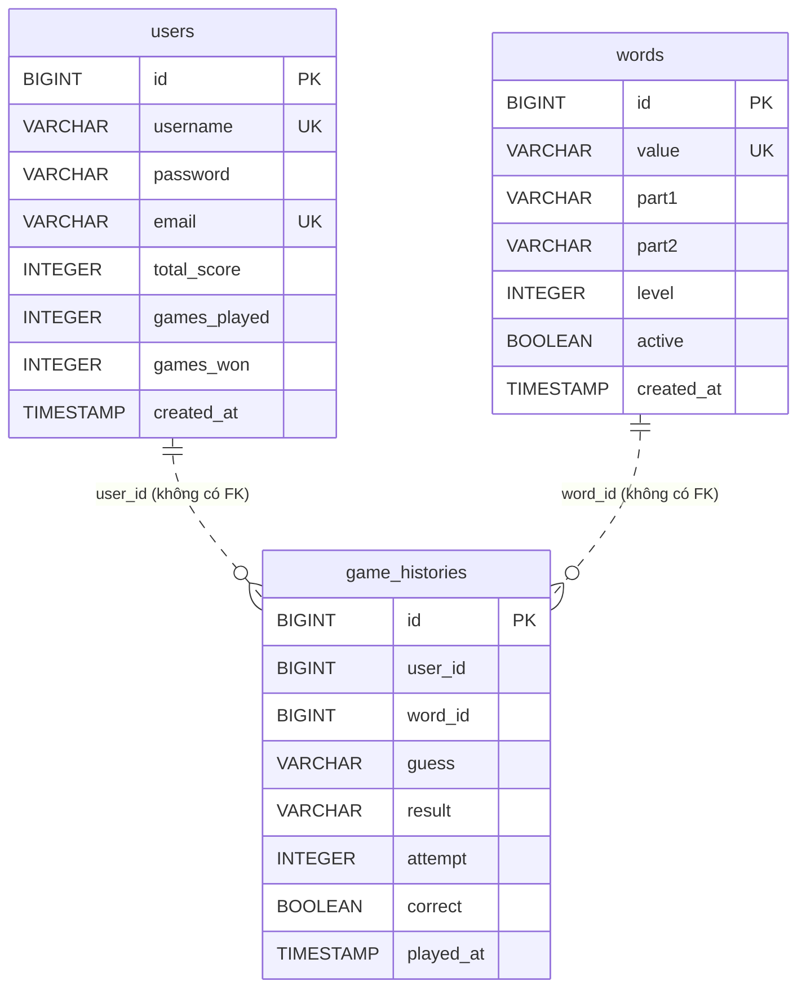

# Thiết kế cơ sở dữ liệu — game_word_db

## 1. Mục đích và phạm vi

- **Mục đích:** Mô tả schema **hiện tại (Current)** của PostgreSQL theo Liquibase changelog `v1.0.0` và JPA entity.
- **Đối tượng đọc:** Lập trình viên backend, DBA.
- **Nguồn sự thật:** `backend/game-word-server/src/main/resources/db/changelog/`. Hibernate chạy `ddl-auto=validate` nên entity phải khớp changelog.

## 2. ERD — Current

Quan hệ chỉ là logic: changelog **không tạo foreign key**; entity `GameHistory` lưu `userId`, `wordId` dạng `Long`, không dùng `@ManyToOne`.

## 3. Data dictionary

### 3.1 `users` (entity `com.gameword.model.User`)

| Cột | Kiểu | Null | Mặc định | Ràng buộc | Mô tả |
|-----|------|------|----------|-----------|-------|
| `id` | BIGINT | Không | auto increment | PK | |
| `username` | VARCHAR(255) | Không | | `uk_users_username` | Tên đăng nhập |
| `password` | VARCHAR(255) | Không | | | Hash BCrypt — dữ liệu nhạy cảm |
| `email` | VARCHAR(255) | Không | | `uk_users_email` | Dữ liệu cá nhân; dùng làm subject JWT |
| `total_score` | INTEGER | Có | 0 | | Tổng điểm (hiện không được cập nhật, R-05) |
| `games_played` | INTEGER | Có | 0 | | Số ván đã chơi |
| `games_won` | INTEGER | Có | 0 | | Số ván thắng |
| `created_at` | TIMESTAMP | Có | | | Gán bởi `@PrePersist` |

### 3.2 `words` (entity `Word`)

| Cột | Kiểu | Null | Mặc định | Ràng buộc | Mô tả |
|-----|------|------|----------|-----------|-------|
| `id` | BIGINT | Không | auto increment | PK | |
| `value` | VARCHAR(255) | Không | | `uk_words_value` | Từ ghép, viết hoa, không dấu |
| `part1`, `part2` | VARCHAR(255) | Không | | | Hai thành phần của từ ghép |
| `level` | INTEGER | Không | | | Cấp độ (dữ liệu seed: 1–3) |
| `active` | BOOLEAN | Không | true | | Chỉ từ active mới được random |
| `created_at` | TIMESTAMP | Có | | | Gán bởi `@PrePersist` |

### 3.3 `game_histories` (entity `GameHistory`)

| Cột | Kiểu | Null | Ràng buộc | Mô tả |
|-----|------|------|-----------|-------|
| `id` | BIGINT | Không | PK | |
| `user_id` | BIGINT | Có | index `idx_histories_user` | Null với người chơi khách |
| `word_id` | BIGINT | Không | index `idx_histories_word` | |
| `guess` | VARCHAR(255) | Không | | Chuỗi đoán đã chuẩn hóa chữ hoa; `""` cho bản ghi bắt đầu ván |
| `result` | VARCHAR(255) | Không | | Danh sách màu, phân cách dấu phẩy |
| `attempt` | INTEGER | Không | | Số thứ tự lượt; `0` = bản ghi bắt đầu ván |
| `correct` | BOOLEAN | Không | | |
| `played_at` | TIMESTAMP | Có | | Gán bởi `@PrePersist` |

## 4. Migration

| Changeset | Tác giả | Nội dung |
|-----------|---------|----------|
| `1` | kilo | Tạo `users` |
| `2` | kilo | Tạo `words` |
| `3` | kilo | Tạo `game_histories` |
| `4` | kilo | Index `idx_histories_user`, `idx_histories_word` |

- Master: `db/changelog/db.changelog-master.xml` → include `v1.0.0/initial-schema.xml`.
- Liquibase chạy tự động khi ứng dụng khởi động (`spring.liquibase.enabled=true`).
- Quy trình code-first: `liquibase-maven-plugin` + `liquibase-hibernate6` sinh diff vào `db/changelog/generated/` (`mvn liquibase:diff` / `diffChangeLog`) dựa trên `liquibase.properties` (chỉ dùng local).
- Thay đổi schema mới: thêm file changelog mới (ví dụ `v1.1.0/...xml`) và include vào master; **không sửa changeset đã chạy**.

## 5. Dữ liệu khởi tạo

`GameWordServerApplication.init` chèn 20 từ (level 1–3) khi bảng `words` rỗng. Seed nằm trong code Java, không nằm trong Liquibase.

## 6. Truy vấn đáng chú ý

| Repository method | Ghi chú |
|-------------------|---------|
| `WordRepository.findRandomNotIn` / `findRandomByLevelNotIn` | JPQL `ORDER BY RANDOM()` trả `Optional<Word>` nhưng không giới hạn 1 bản ghi (R-07) |
| `GameHistoryRepository.findByWordId` | Dùng để đếm lượt — không lọc theo người dùng (R-04) |
| `UserRepository.findAll(Sort)` | Leaderboard tải toàn bộ bảng `users` vào bộ nhớ |

## 7. Lưu trữ và vòng đời dữ liệu

- Docker volume `game_word_db_data` lưu dữ liệu PostgreSQL.
- `OPEN QUESTION:` Chưa có chính sách backup, retention cho `game_histories` hay xóa dữ liệu người dùng.

## 8. Lịch sử thay đổi

| Phiên bản | Ngày | Mô tả |
|-----------|------|-------|
| 0.1 | 2026-10-24 | Khởi tạo từ changelog v1.0.0 |
