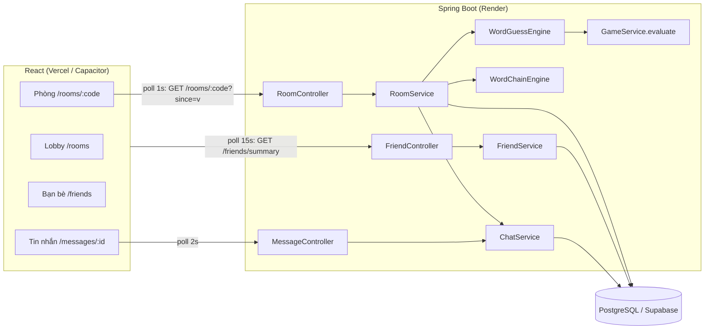
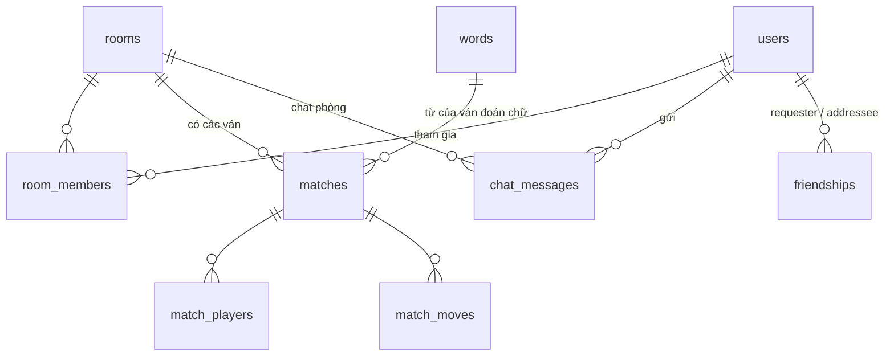
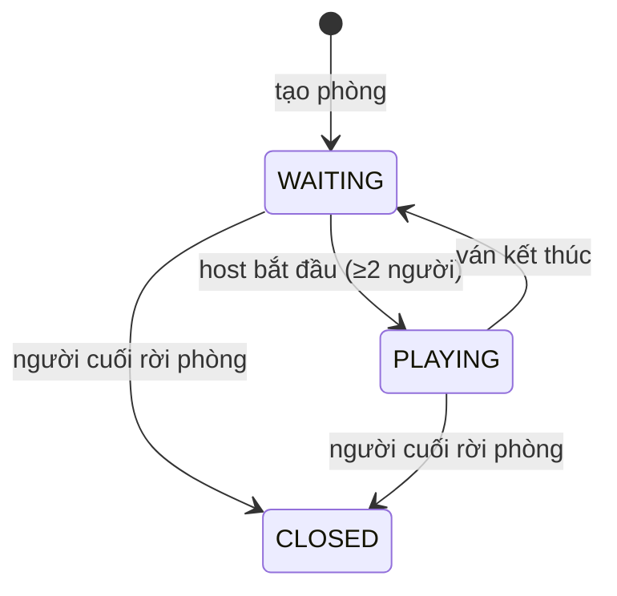

# Thiết kế Phase 2: Phòng chơi nhiều người, chat, kết bạn

> Toàn bộ tài liệu là **Proposed** (chưa triển khai). Cần duyệt mục 12 (câu hỏi mở) trước khi code.

## 1. Mục đích và phạm vi

- **Mục đích:** Thống nhất luật chơi, kiến trúc, dữ liệu, API và kế hoạch triển khai trước khi lập trình.
- **Đối tượng đọc:** Chủ dự án, lập trình viên backend/frontend.
- **Bao gồm:**
  1. Phòng chơi (room) cho người đã đăng nhập, vào bằng mã phòng, có **chat chung trong phòng**.
  2. Chế độ **Đua đoán chữ**: mọi người đoán cùng một từ, độc lập; ai đoán đúng trước thắng.
  3. Chế độ **Nối từ**: theo lượt, sai hoặc hết giờ bị loại, người cuối cùng còn lại thắng.
  4. **Kết bạn** và **nhắn tin riêng** giữa bạn bè.
- **Không bao gồm:** phòng công khai/ghép trận tự động, chặn người dùng, báo cáo vi phạm, thông báo đẩy (push), gửi ảnh/emoji đặc biệt, cộng điểm bảng xếp hạng từ phòng chơi.

### 1.1 Quyết định đã chốt (2026-10-30)

| # | Chủ đề | Quyết định | Lý do |
|---|--------|------------|-------|
| D1 | Thời gian thực | **Polling REST** | Vercel rewrite `/api` không chuyển tiếp WebSocket; chạy được ngay với web + app Capacitor. Thắng thua do server tính theo thời điểm nhận, độ trễ polling không ảnh hưởng công bằng |
| D2 | Luật Nối từ | **Theo lượt + loại dần** | Sai hoặc hết giờ bị loại, người cuối cùng thắng |
| D3 | Điểm | **Không cộng** vào bảng xếp hạng | Tránh cày điểm bằng nick phụ |
| D4 | Lưu trữ | **Database** (PostgreSQL) | Không mất phòng khi server restart, xem lại được kết quả |
| D5 | Chat phòng | Mỗi phòng có kênh chat chung | Yêu cầu bổ sung |
| D6 | Mạng xã hội | Kết bạn + nhắn tin riêng 1-1 | Yêu cầu bổ sung |

## 2. Thuật ngữ

| Thuật ngữ | Định nghĩa |
|-----------|------------|
| Phòng (room) | Nhóm người chơi, định danh bằng mã 6 ký tự. Tồn tại qua nhiều ván |
| Ván (match) | Một lượt chơi trong phòng, thuộc một chế độ (`WORD_GUESS` hoặc `WORD_CHAIN`) |
| Chủ phòng (host) | Người tạo phòng; được bắt đầu ván, đổi chế độ chơi |
| Người xem | Thành viên vào phòng khi ván đang diễn ra; xem và chat, chơi từ ván sau |
| `version` phòng | Số tăng mỗi khi phòng có thay đổi (kể cả chat); dùng để polling rẻ |

## 3. Luật chơi

### 3.1 Chung

- Chỉ người **đã đăng nhập** được tạo/vào phòng. Tối đa **8** thành viên/phòng.
- Phòng là **riêng tư**: chỉ vào được khi biết mã (hoặc được bạn bè mời, mục 3.5).
- Chủ phòng bấm **Bắt đầu** khi có **≥ 2** thành viên. Mọi thành viên lúc đó là người chơi của ván.
- Hết ván, phòng về trạng thái chờ; chủ phòng có thể bắt đầu ván mới (cùng hoặc khác chế độ).
- Chủ phòng rời phòng → quyền chủ chuyển cho người vào sớm nhất còn lại. Phòng không còn ai → đóng.
- Rời phòng khi đang chơi = bỏ cuộc (bị loại khỏi ván).

### 3.2 Đua đoán chữ (`WORD_GUESS`)

- Server chọn ngẫu nhiên **một từ chung** (dùng `WordService.getRandomWord`, cân bằng theo cấp độ như chơi đơn).
- Mỗi người có **10 lượt** (`game.guess.max-attempts`), chấm màu giống hệt chơi đơn (`GameService.evaluateGuess`).
- **Người gửi đáp án đúng đầu tiên (theo thời điểm server nhận) thắng** → ván kết thúc ngay cho mọi người.
- Người hết 10 lượt mà chưa đúng: dừng, xem người khác chơi.
- Ván kết thúc **không có người thắng** khi: tất cả hết lượt/bỏ cuộc, hoặc hết **thời gian ván 5 phút**.
- Trong lúc chơi, mỗi người thấy: bảng của mình (đủ chữ + màu) và **bảng thu nhỏ của đối thủ chỉ có màu, không có chữ** (kiểu Wordle đối kháng), để không lộ đáp án.
- Hết ván: hiện đáp án + giải nghĩa cho tất cả.

### 3.3 Nối từ (`WORD_CHAIN`)

- Thứ tự lượt: xáo trộn ngẫu nhiên lúc bắt đầu. Server đưa ra **từ mở đầu** ngẫu nhiên (từ 2 tiếng có trong từ điển).
- Đến lượt mình, người chơi có **20 giây** nhập một từ **2 tiếng** sao cho **tiếng đầu = tiếng cuối của từ trước** (giữ nguyên dấu; không phân biệt hoa thường). Ví dụ: `máy tính` → `tính toán` → `toán học`.
- Từ hợp lệ khi: có trong từ điển (`words.phrase`, ~45.000 từ) **và** chưa được dùng trong ván.
- **Bị loại** khi: hết giờ; hoặc gửi từ không có trong từ điển; hoặc từ đã dùng.
- **Không bị loại** (chỉ báo lỗi, được nhập lại trong thời gian còn lại) khi lỗi định dạng: rỗng, không đủ 2 tiếng, tiếng đầu không khớp. Giao diện điền sẵn tiếng đầu, người chơi chỉ gõ tiếng thứ hai, nên lỗi này hầu như không xảy ra (xem câu hỏi mở Q1).
- Còn **1 người** → người đó thắng. Lượt không giới hạn số vòng.

### 3.4 Chat phòng

- Mọi thành viên (kể cả người xem) gửi được tin nhắn văn bản ≤ 500 ký tự.
- Server tự sinh **tin hệ thống** vào kênh chat: vào/rời phòng, bắt đầu ván, ai bị loại (lý do), ai thắng, đáp án.
- Hiển thị 50 tin gần nhất khi vào phòng, sau đó nhận tin mới qua polling.

### 3.5 Kết bạn và nhắn tin riêng

- Tìm người theo **tên tài khoản** (khớp tiền tố, tối đa 10 kết quả). Không tìm theo email (bảo vệ riêng tư).
- Gửi lời mời → người nhận **chấp nhận** hoặc **từ chối**; người gửi có thể **hủy**. A gửi cho B trong khi B đã gửi cho A → tự động thành bạn.
- Hủy kết bạn: một trong hai bên. Lịch sử tin nhắn được giữ.
- **Chỉ bạn bè** nhắn tin riêng được cho nhau. Có đếm tin chưa đọc, badge trên thanh điều hướng.
- **Mời vào phòng:** trong phòng có nút "Mời bạn" → gửi tin nhắn riêng loại `ROOM_INVITE` kèm mã phòng; người nhận bấm để vào.

## 4. Kiến trúc



- Module mới nằm trong cùng backend (monolith), theo cấu trúc hiện có: `controller` / `service` / `repository` / `model` / `dto`.
- Hai "engine" tách luật riêng của từng chế độ khỏi `RoomService` (quản lý phòng, thành viên, quyền). Thêm chế độ mới sau này chỉ cần thêm engine.
- Logic chấm màu được **tách khỏi** `GameService.makeGuess` thành hàm dùng chung `evaluate(Word, rawGuess)` (giữ nguyên hành vi chơi đơn).

### 4.1 Polling và đồng bộ

| Màn hình | Endpoint | Chu kỳ | Ghi chú |
|----------|----------|--------|---------|
| Phòng (đang chơi) | `GET /api/rooms/{code}?since={version}&afterMessageId={id}` | 1 giây | |
| Phòng (đang chờ) | như trên | 2 giây | |
| Hội thoại riêng | `GET /api/messages/{friendId}?afterId={id}` | 2 giây | |
| Badge (mọi trang) | `GET /api/friends/summary` | 15 giây | Số lời mời chờ + tin chưa đọc |

- **Polling rẻ bằng `version`:** bảng `rooms` có cột `version` tăng ở mọi thay đổi (thành viên, nước đi, chat). Client gửi `since` = version đã biết. Nếu không đổi và chưa tới hạn sự kiện hẹn giờ → trả `{ "version": v, "changed": false }` sau **1 truy vấn**. Chỉ khi đổi mới tải đầy đủ.
- **Dừng polling khi tab ẩn** (`document.visibilityState`), poll ngay khi tab hiện lại.
- **Đồng hồ:** mọi response có `serverTime` (epoch ms); client tính độ lệch để đếm ngược theo giờ server. Hạn chót luôn do server quyết.
- **Sự kiện hẹn giờ không cần scheduler:** hết lượt Nối từ / hết giờ Đua đoán chữ được xử lý **lười** (lazy) ở request kế tiếp chạm vào phòng (poll hoặc nước đi). Bảng `rooms` có `deadline_at` (hạn sự kiện gần nhất) để nhánh polling rẻ cũng phát hiện được. Vì mọi người chơi đều poll mỗi giây, độ trễ xử lý ≤ ~1 giây.

### 4.2 Đồng thời (concurrency)

- Mọi thao tác thay đổi phòng/ván (vào, rời, bắt đầu, đoán, nối, xử lý hết giờ, chat) chạy trong transaction và **khóa dòng `rooms`** (`SELECT … FOR UPDATE`, `@Lock(PESSIMISTIC_WRITE)`). Các thao tác trong cùng phòng được tuần tự hóa → không thể có 2 người cùng "thắng", không bị trùng lượt.
- Khóa theo phòng nên các phòng khác nhau không chặn nhau. Thời gian giữ khóa chỉ vài ms.
- "Ai đúng trước" = transaction nào lấy được khóa trước; transaction sau thấy ván đã `FINISHED` và nhận thông báo "Ván đã kết thúc".

## 5. Mô hình dữ liệu (migration v1.6.0, v1.7.0)



### 5.1 v1.6.0: phòng, ván, chat

| Bảng | Cột | Ghi chú |
|------|-----|---------|
| `rooms` | `id` PK, `code` VARCHAR(8) **unique**, `host_id` FK users, `game_type` VARCHAR(20), `status` VARCHAR(20) (`WAITING`/`PLAYING`/`CLOSED`), `current_match_id` BIGINT null, `version` BIGINT, `deadline_at` TIMESTAMP null, `created_at`, `updated_at` | Mã phòng: 6 ký tự từ bảng chữ không dễ nhầm (bỏ 0/O/1/I) |
| `room_members` | `id` PK, `room_id` FK cascade, `user_id` FK, `joined_at` | unique(`room_id`,`user_id`); index `user_id` (danh sách phòng của tôi) |
| `matches` | `id` PK, `room_id` FK cascade, `game_type`, `status` (`PLAYING`/`FINISHED`), `word_id` FK words null, `winner_id` FK users null, `current_user_id` null, `turn_deadline` null, `ends_at` null, `last_word` VARCHAR(255) null, `started_at`, `finished_at` null | `word_id`/`ends_at`: Đua đoán chữ. `current_user_id`/`turn_deadline`/`last_word`: Nối từ |
| `match_players` | `id` PK, `match_id` FK cascade, `user_id` FK, `turn_order` INT, `eliminated` BOOLEAN, `eliminated_reason` VARCHAR(20) null, `attempts` INT, `solved_at` TIMESTAMP null | unique(`match_id`,`user_id`) |
| `match_moves` | `id` PK, `match_id` FK cascade, `user_id` FK null, `content` VARCHAR(255), `result` VARCHAR(255) null, `correct` BOOLEAN, `created_at` | Đoán chữ: `content`=cụm đoán, `result`=màu CSV như `game_histories`. Nối từ: `content`=từ, `user_id` null cho từ mở đầu. Index (`match_id`,`id`) |
| `chat_messages` | `id` PK, `room_id` FK cascade null, `sender_id` FK null, `recipient_id` FK null, `type` VARCHAR(20) (`TEXT`/`SYSTEM`/`ROOM_INVITE`), `content` VARCHAR(500), `created_at`, `read_at` null | Tin phòng: `room_id` ≠ null. Tin riêng: `recipient_id` ≠ null. Tin hệ thống: `sender_id` null. Index (`room_id`,`id`), (`recipient_id`,`sender_id`,`id`), (`sender_id`,`recipient_id`,`id`) |

### 5.2 v1.7.0: bạn bè

| Bảng | Cột | Ghi chú |
|------|-----|---------|
| `friendships` | `id` PK, `requester_id` FK, `addressee_id` FK, `status` (`PENDING`/`ACCEPTED`), `created_at`, `responded_at` null | unique(`requester_id`,`addressee_id`); service đảm bảo không tồn tại cặp ngược chiều. Từ chối/hủy = xóa dòng |

- Các bảng mới phải chạy lại `deploy/supabase-harden.sh` sau khi deploy (bật RLS).
- Dữ liệu không xóa tự động trong phase này (xem Q7).

## 6. Máy trạng thái



Ván Nối từ, mỗi sự kiện (nước đi / hết giờ / rời phòng) chạy:

1. Hợp lệ → ghi `match_moves`, `last_word` = từ mới, chuyển lượt cho người **chưa bị loại** kế tiếp theo `turn_order`, `turn_deadline` = now + 20s.
2. Bị loại → `eliminated = true` (+ lý do), tin hệ thống. Còn 1 người → `winner_id`, `FINISHED`. Ngược lại chuyển lượt như trên.
3. Hết giờ được xử lý lười: mỗi request xử lý tối đa 1 lần hết giờ rồi đặt hạn mới tính từ hiện tại (tránh loại liên hoàn nhiều người do không ai poll).

## 7. API (mọi endpoint yêu cầu JWT)

Lỗi theo quy ước hiện có: HTTP 400 + `{ status, message }` với message tiếng Anh/không dấu, frontend dịch trong `KNOWN_MESSAGES`.

### 7.1 Phòng

| Method | Path | Body | Trả về | Quyền |
|--------|------|------|--------|-------|
| POST | `/api/rooms` | `{ gameType }` | `RoomState` | Đăng nhập |
| GET | `/api/rooms/mine` | — | `RoomSummary[]` | Đăng nhập |
| POST | `/api/rooms/{code}/join` | — | `RoomState` | Phòng chưa đầy, chưa đóng |
| POST | `/api/rooms/{code}/leave` | — | `MessageResponse` | Thành viên |
| GET | `/api/rooms/{code}?since=&afterMessageId=` | — | `RoomState` hoặc `{version, changed:false}` | Thành viên |
| POST | `/api/rooms/{code}/start` | `{ gameType }` | `RoomState` | Host, `WAITING`, ≥2 người |
| POST | `/api/rooms/{code}/guess` | `{ guess }` | `RoomState` | Người chơi Đua đoán chữ |
| POST | `/api/rooms/{code}/chain` | `{ word }` | `RoomState` | Người đang tới lượt |
| POST | `/api/rooms/{code}/messages` | `{ content }` | `ChatMessage` | Thành viên |
| POST | `/api/rooms/{code}/invite` | `{ friendId }` | `MessageResponse` | Thành viên, là bạn bè |

`RoomState` (tùy theo người xem):

```json
{
  "code": "K7QM2X", "status": "PLAYING", "gameType": "WORD_GUESS", "hostId": 1,
  "version": 42, "serverTime": 1793350000000,
  "members": [{ "userId": 1, "username": "an", "host": true }],
  "match": {
    "id": 9, "gameType": "WORD_GUESS", "status": "PLAYING", "winnerId": null, "endsAt": 1793350300000,
    "players": [{ "userId": 2, "username": "binh", "attempts": 3, "eliminated": false, "solved": false,
                  "colorRows": [["GREEN","BLACK","YELLOW","BLACK","BLUE","BLACK","BLACK"]] }],
    "wordLength": 7, "partLengths": [3, 4], "maxAttempts": 10,
    "myRows": [[{ "index": 0, "letter": "V", "color": "GREEN", "label": "xanh la" }]],
    "answer": null, "definition": null,
    "currentUserId": null, "turnDeadline": null, "requiredSyllable": null, "chain": []
  },
  "messages": [{ "id": 100, "type": "SYSTEM", "senderId": null, "senderName": null,
                 "content": "binh đã vào phòng", "createdAt": 1793349990000 }]
}
```

- Đáp án (`answer`) và chữ trên bảng người khác **không bao giờ** được gửi khi ván đang chơi.
- Nối từ: `chain` = 50 từ gần nhất `{ userId, username, word }`, `requiredSyllable` = tiếng cần nối.

### 7.2 Bạn bè và tin nhắn

| Method | Path | Body | Trả về |
|--------|------|------|--------|
| GET | `/api/friends` | — | `{ friends[], incoming[], outgoing[] }` (kèm `unread` theo bạn) |
| GET | `/api/friends/summary` | — | `{ pendingRequests, unreadMessages }` |
| GET | `/api/friends/search?q=` | — | `[{ userId, username, relation }]` (`NONE`/`FRIEND`/`INCOMING`/`OUTGOING`) |
| POST | `/api/friends/requests` | `{ username }` | `MessageResponse` |
| POST | `/api/friends/requests/{userId}/accept` | — | `MessageResponse` |
| DELETE | `/api/friends/requests/{userId}` | — | Từ chối (nếu là lời mời đến) hoặc hủy (nếu mình gửi) |
| DELETE | `/api/friends/{userId}` | — | Hủy kết bạn |
| GET | `/api/messages/{friendId}?afterId=` | — | `ChatMessage[]` (50 gần nhất nếu không có `afterId`); đánh dấu đã đọc |
| POST | `/api/messages/{friendId}` | `{ content }` | `ChatMessage` |

## 8. Frontend

| Route | Trang | Thành phần chính |
|-------|-------|------------------|
| `/rooms` | Sảnh | Tạo phòng (chọn chế độ), nhập mã để vào, danh sách "Phòng của tôi" |
| `/rooms/:code` | Phòng | Cột trái: khu vực chơi. Cột phải: thành viên + chat. Mobile: tab "Chơi / Chat" |
| `/friends` | Bạn bè | Ô tìm kiếm, lời mời đến/đi, danh sách bạn (badge chưa đọc) |
| `/messages/:userId` | Hội thoại | Danh sách tin, ô nhập, thẻ mời vào phòng bấm được |

- Thanh điều hướng thêm "Phòng" và "Bạn bè" (có badge), chỉ hiện khi đã đăng nhập; đều bọc `ProtectedRoute`.
- **Tái sử dụng:** `GameBoard`, `GuessInput`, `countLetters`/`formatGuess` (chơi đơn). **Mới:** `usePolling` (chung, tự dừng khi tab ẩn), `useRoom`, `MiniBoard` (bảng chỉ màu của đối thủ), `ChainBoard`, `ChainInput` (tiếng đầu cố định + ô nhập tiếng thứ hai), `Countdown`, `ChatPanel`, `MemberList`.
- Code tổ chức theo feature như hiện tại: `src/features/rooms/…`, `src/features/social/…`.

## 9. Bảo mật và chống lạm dụng

| Rủi ro | Biện pháp |
|--------|-----------|
| Lộ đáp án qua API | Chỉ trả chữ của chính người xem; đáp án chỉ khi `FINISHED`. Không dùng `/api/words/random` cho phòng |
| Gian lận Nối từ (gửi hộ, gửi khi không tới lượt) | Người chơi lấy từ JWT; kiểm tra lượt, hạn chót và từ điển ở server |
| Xem phòng/tin nhắn của người khác | Kiểm tra là thành viên phòng / một trong hai bên hội thoại / là bạn bè |
| Spam chat, spam lời mời | Giới hạn 500 ký tự; tối đa ~1 tin/giây/người (bộ nhớ); lời mời kết bạn chờ tối đa 50 |
| Dò tên người dùng | Tìm kiếm yêu cầu ≥ 2 ký tự, trả tối đa 10 |
| XSS qua chat | React tự escape; không render HTML/markdown từ tin nhắn |
| Token bị thu hồi khi đang trong phòng | Endpoint phòng yêu cầu JWT → 403 → frontend tự đăng xuất (cơ chế đã có) |

## 10. Ảnh hưởng triển khai và hiệu năng

- **Không cần thêm dịch vụ hay biến môi trường.** Vẫn Render + Supabase + Vercel.
- **Tải ước tính:** 8 người trong phòng, poll 1 giây ≈ 8 req/s; phần lớn trả về "không đổi" sau 1 truy vấn theo khóa chính. Pool Hikari 3 kết nối (Render) đủ cho vài phòng đồng thời. Nếu tăng tải: nâng chu kỳ poll lúc chờ lên 3 giây, hoặc chuyển sang WebSocket (giữ nguyên tầng service).
- **Render Free ngủ sau 15 phút** không có request: phòng vẫn lưu trong DB; người chơi quay lại thì mất ~30-60 giây đánh thức máy chủ, sau đó chơi tiếp được.
- **Supabase:** chạy lại `deploy/supabase-harden.sh` sau mỗi migration tạo bảng.

## 11. Kế hoạch triển khai

Mỗi mốc là một nhánh/PR riêng, có test, deploy được độc lập.

| Mốc | Nội dung | Phụ thuộc | Cỡ |
|-----|----------|-----------|----|
| **M1. Phòng + chat phòng** | Migration v1.6.0; `Room`, `RoomMember`, `ChatMessage`; tạo/vào/rời/xem phòng, chuyển host, polling `version`; tin hệ thống; trang Sảnh + trang Phòng (thành viên, chat) | — | L |
| **M2. Đua đoán chữ** | Tách `GameService.evaluate`; `Match`, `MatchPlayer`, `MatchMove`; `WordGuessEngine`; bắt đầu ván, đoán, hết giờ; `MiniBoard`, màn kết quả | M1 | L |
| **M3. Nối từ** | `WordChainEngine`; tra từ điển theo `phrase`; xử lý lượt/hết giờ lười; `ChainBoard`, `ChainInput`, `Countdown` | M2 (dùng chung bảng ván) | M |
| **M4. Kết bạn + nhắn tin** | Migration v1.7.0; `Friendship`; tìm kiếm, lời mời, danh sách; tin nhắn riêng, chưa đọc, badge; mời vào phòng | M1 (dùng `chat_messages`) | L |
| **M5. Hoàn thiện** | Test tích hợp (Testcontainers PostgreSQL cho khóa/concurrency), cập nhật DOC-001/002/003, giới hạn spam, kiểm thử trên mobile | M1-M4 | M |

**Kiểm thử chính:**

- Unit: engine Nối từ (nối đúng/sai tiếng, từ đã dùng, ngoài từ điển, hết giờ, người cuối thắng), engine Đua đoán chữ (đúng trước thắng, hết lượt, hết giờ), quan hệ bạn bè (mời chéo tự thành bạn).
- Tích hợp: 2 request "đoán đúng" đồng thời → chỉ 1 người thắng; polling `since` trả `changed:false`.
- Frontend: reducer/hook phòng, `ChainInput`, `MiniBoard` không hiển thị chữ đối thủ.

## 12. Câu hỏi mở (cần chủ dự án xác nhận)

| # | Câu hỏi | Đề xuất mặc định |
|---|---------|------------------|
| Q1 | Nối từ: gõ sai chính tả (từ không có trong từ điển) có bị loại ngay không, hay cho thử lại trong 20 giây? | **Loại ngay** theo luật đã chọn; lỗi định dạng thì không loại |
| Q2 | Thông số: 8 người/phòng, 20 giây/lượt Nối từ, 5 phút/ván Đua đoán chữ, 10 lượt đoán | Như bên trái, đặt trong `application.properties` để chỉnh được |
| Q3 | Đua đoán chữ: cho đối thủ thấy **màu** (không thấy chữ) của nhau? | **Có** |
| Q4 | Người vào giữa ván: làm người xem, chơi từ ván sau? | **Có** |
| Q5 | Có cần danh sách phòng công khai để người lạ vào? | **Không** (chỉ mã phòng + mời bạn) |
| Q6 | Chỉ bạn bè mới nhắn tin riêng được? | **Có** |
| Q7 | Thời gian lưu chat/ván cũ? | Giữ vô thời hạn ở phase này; thêm dọn dẹp khi dữ liệu lớn |
| Q8 | Có lưu lịch sử đấu (thắng/thua trong phòng) để hiển thị trong hồ sơ không? | Dữ liệu có sẵn trong `matches`; giao diện để phase sau |

## 13. Nguồn bằng chứng

- `GameService.evaluateGuess`, `displayLetters`, `partLengths`: logic chấm màu dùng lại.
- `WordService.getRandomWord`: chọn từ cân bằng cấp độ.
- `v1.3.0/words-vi-all.csv`: `phrase` dạng chữ thường có dấu, unique (`uk_words_phrase`), dùng tra từ điển Nối từ.
- `SecurityConfig`: `anyRequest().authenticated()` bao phủ các endpoint mới.
- `frontend/vercel.json`: rewrite `/api/:path*` sang Render (không hỗ trợ WebSocket), căn cứ cho D1.
- `render.yaml`: 1 instance gói Free, `SPRING_DATASOURCE_HIKARI_MAXIMUM_POOL_SIZE=3`.

## 14. Lịch sử thay đổi

| Phiên bản | Ngày | Mô tả |
|-----------|------|-------|
| 0.1 | 2026-10-30 | Khởi tạo bản thiết kế để review |
